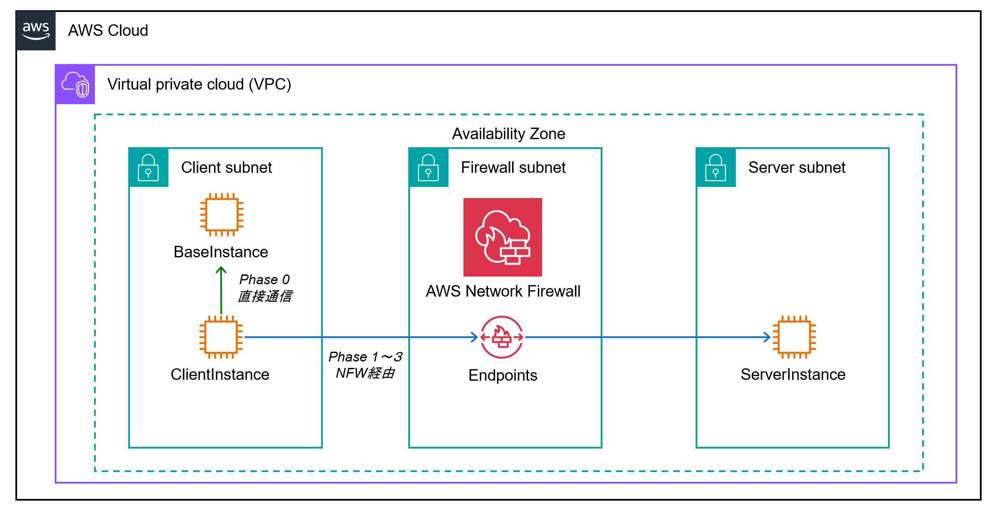

# AWS Network Firewall Latency Benchmark

Measure the latency overhead added by AWS Network Firewall at each inspection level: stateless rules, stateful rules (Suricata), and TLS inspection. All infrastructure is defined in CDK and can be reproduced end-to-end in about 30 minutes.

## Architecture



```
VPC 10.0.0.0/16  (single AZ)

  Client Subnet 10.0.0.0/24          Firewall Subnet 10.0.1.0/24     Server Subnet 10.0.2.0/24
  ┌─────────────────────────┐         ┌────────────────────────┐      ┌──────────────────────┐
  │  ClientInst             │──Route A▶│  NFW Endpoint          │─────▶│  ServerInst          │
  │  BaselineInst (Phase 0) │─Route B─▶│  (direct, no firewall) │      │  (iperf3 / nginx)    │
  └─────────────────────────┘         └────────────────────────┘      └──────────────────────┘

Route A (Phase 1/2/3): ClientInst → NFW Endpoint → ServerInst
Route B (Phase 0):     ClientInst → BaselineInst  (same subnet, no firewall)
```

All instances are in private isolated subnets (no NAT). Access is via SSM Session Manager using VPC interface endpoints.

## Test Phases

| Phase | Configuration | Measured Overhead (p50 TCP RTT) |
|---|---|---|
| Phase 0 | Baseline — same subnet direct | reference (0 ms added) |
| Phase 1 | Stateless rules only (pass all) | +0.8 ms |
| Phase 2 | Stateful Suricata rules (pass all) | +0.6 ms p50 / +3.5 ms p99 ※ |
| Phase 3 | TLS inspection enabled | +1.7 ms per TLS handshake |

> ※ Phase 1 と Phase 2 の p50 差は nping の分解能（0.1ms）以内であり、ステートレス vs ステートフルの差は本計測条件（同一クライアントからの繰り返し接続）では比較できなかった。

## Prerequisites

- [Node.js](https://nodejs.org/) 18 or later
- [AWS CLI v2](https://docs.aws.amazon.com/cli/latest/userguide/getting-started-install.html) configured with a profile that has permissions to deploy VPC, EC2, Network Firewall, ACM, and CloudWatch resources
- [AWS CDK v2](https://docs.aws.amazon.com/cdk/v2/guide/getting_started.html): `npm install -g aws-cdk`
- `jq` (used by scripts): `brew install jq` / `apt install jq`

Export your AWS profile before running any command:

```bash
export AWS_PROFILE=your-profile
export AWS_REGION=ap-northeast-1   # or your preferred region
```

## Step-by-Step

### 1. Install dependencies and bootstrap

```bash
npm install
npx cdk bootstrap   # only needed once per account/region
```

### 2. Deploy the stack

```bash
npx cdk deploy --outputs-file outputs.json --require-approval never
```

`outputs.json` is created at the project root (gitignored). All subsequent scripts read it automatically.

### 3. Configure route tables

CDK cannot obtain the NFW endpoint ID at deploy time, so routes must be added after deployment:

```bash
./scripts/setup-routes.sh
# Pass a custom outputs.json path if needed:
# ./scripts/setup-routes.sh /path/to/outputs.json
```

This creates two routes:
- Client subnet RT → `10.0.2.0/24` via NFW endpoint
- Server subnet RT → `10.0.0.0/24` via NFW endpoint

### 4. Transfer `bench.sh` to the client instance

The instances have no internet access. Use SSM to copy the script via base64:

```bash
CLIENT_ID=$(jq -r '.NfwLatencyBenchStack.ClientInstanceId' outputs.json)

# Encode and send
ENCODED=$(base64 -w0 bench.sh)
aws ssm send-command \
  --instance-ids "${CLIENT_ID}" \
  --document-name "AWS-RunShellScript" \
  --parameters "commands=[
    'echo ${ENCODED} | base64 -d > /tmp/bench.sh',
    'chmod +x /tmp/bench.sh'
  ]" \
  --query 'Command.CommandId' --output text
```

### 5. Run benchmarks for each phase

For each phase, switch the firewall policy and then run the benchmark.

```bash
SERVER_IP=$(jq -r '.NfwLatencyBenchStack.ServerPrivateIp' outputs.json)
BASELINE_IP=$(jq -r '.NfwLatencyBenchStack.BaselinePrivateIp' outputs.json)
CLIENT_ID=$(jq -r '.NfwLatencyBenchStack.ClientInstanceId' outputs.json)

# Open an SSM session on the client instance
aws ssm start-session --target "${CLIENT_ID}"
```

Inside the session:

```bash
# Phase 1 — stateless rules only
exit  # back to local shell first
./scripts/switch-phase.sh 1   # waits 30 s for policy to propagate
aws ssm start-session --target "${CLIENT_ID}"
sudo /tmp/bench.sh <SERVER_IP> <BASELINE_IP>

# Phase 2 — stateful Suricata rules
exit
./scripts/switch-phase.sh 2
aws ssm start-session --target "${CLIENT_ID}"
sudo /tmp/bench.sh <SERVER_IP> <BASELINE_IP>

# Phase 3 — TLS inspection (generates cert, imports to ACM, creates TLS config)
exit
./scripts/switch-phase.sh 3
aws ssm start-session --target "${CLIENT_ID}"
sudo /tmp/bench.sh <SERVER_IP> <BASELINE_IP>
```

`switch-phase.sh` reads `outputs.json` automatically. To use a different file:

```bash
./scripts/switch-phase.sh 1 /path/to/outputs.json
```

### 6. Destroy all resources

```bash
npx cdk destroy
```

Note: ACM certificates and TLS inspection configurations created by `switch-phase.sh 3` are not managed by CDK and must be deleted manually from the AWS console or CLI if needed.

## Measurement Details

| Metric | Tool | Notes |
|---|---|---|
| TCP RTT p50/p95/p99 | `nping --tcp -p 5201 -c 100` | Primary metric; μs-level precision |
| ICMP RTT avg | `ping -c 100` | Reference only |
| Throughput + retransmits | `iperf3 -t 10 -J` | Checks for throughput impact |
| HTTPS TLS handshake p50/p95/p99 | `curl` (50 reps) | Phase 3 only; auto-detected |

`bench.sh` auto-selects `nping` (from the `nmap` package, pre-installed by UserData) and falls back to `hping3` if available. It prints a comparison table with absolute values and delta vs. baseline.

## Cost Estimate (ap-northeast-1)

| Resource | Rate |
|---|---|
| c5.large × 3 | ~$0.108/h × 3 = $0.324/h |
| NFW endpoint | $0.395/h |
| VPC endpoints × 3 (SSM) | ~$0.014/h × 3 = $0.042/h |
| **Total** | **~$0.76/h** |

Running all three phases takes about 2 hours: **estimated total ~$1.50**. Destroy resources promptly when done.

## Repository Structure

```
.
├── bin/
│   └── nfw-latency-bench.ts      # CDK entrypoint
├── lib/
│   └── nfw-latency-bench-stack.ts # CDK stack (VPC, EC2, NFW, endpoints)
├── scripts/
│   ├── setup-routes.sh            # Post-deploy route table configuration
│   └── switch-phase.sh            # Firewall policy switcher (Phase 1/2/3)
├── bench.sh                       # Benchmark script (runs on client instance)
├── docs/
│   ├── arch-diagram.png           # Architecture diagram
│   └── nfw-latency-report.html    # Benchmark report with charts
└── outputs.json                   # CDK outputs (gitignored, auto-generated)
```

## References

- [TLS inspection configuration — AWS Security Blog](https://aws.amazon.com/blogs/security/tls-inspection-configuration-for-encrypted-traffic-and-aws-network-firewall/)
- [Network Firewall FAQ](https://aws.amazon.com/network-firewall/faqs/)
- [Deployment models for AWS Network Firewall](https://aws.amazon.com/blogs/networking-and-content-delivery/deployment-models-for-aws-network-firewall/)
