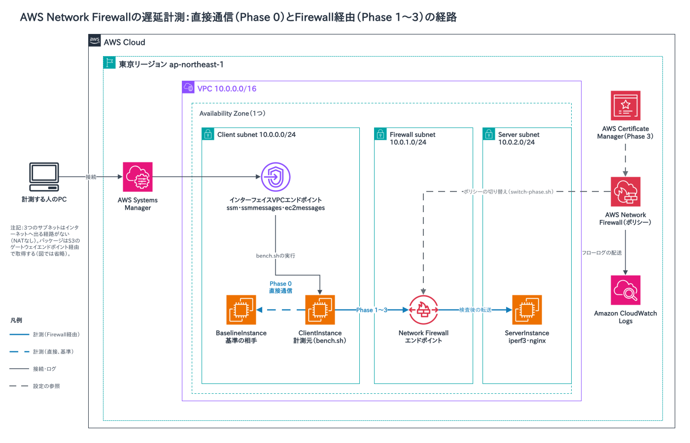

# AWS Network Firewall の遅延計測

AWS Network Firewallを通すと通信の遅延がどれだけ増えるかを、検査の段階(ステートレスルール、ステートフルルール、TLS検査)ごとに計測する環境です。環境はAWS CDKで作るので、同じ条件で計測をやり直せます。

## 計測結果

2026年3月19日に東京リージョンで計測した結果です。詳しい数値は[レポート](docs/nfw-latency-report.html)([PDF](docs/nfw-latency-report.pdf))にあります。レポートの冒頭にも、下の注と同じ内容を追記しています。

| フェーズ | 設定 | 増えた遅延(TCP RTTのp50) |
|---|---|---|
| Phase 0 | 基準。同じサブネットの中で直接通信 | 0 ms(基準) |
| Phase 1 | ステートレスルールのみ(すべて通過) | +0.8 ms |
| Phase 2 | ステートフルルール(Suricata) | 計測できていない(注) |
| Phase 3 | TLS検査 | 計測できていない(注) |

注:Phase 2・3のファイアウォールポリシーにも、TCPとICMPをすべて通過させるステートレスルールグループが入っていた。計測の通信はステートレスの段階で通過してステートフルエンジンに届かないため、Suricataのルールも TLS検査も通っていない。Phase 3では、TLS検査の設定をポリシーに付ける処理も失敗していた。レポートにあるPhase 3の「TLSハンドシェイク +1.7 ms」は、TLS検査なしでもFirewallを通る経路で同じ程度に増えるため、TLS検査による増加ではない。いずれも2026年10月30日の検証で分かった。Phase 2・3を計測するには、ステートレスルールでステートフルエンジンへ送る構成に作り直す必要がある(未対応)。

## 構成



- VPC(10.0.0.0/16)の1つのAZに、Client(10.0.0.0/24)・Firewall(10.0.1.0/24)・Server(10.0.2.0/24)の3つのサブネットを置く。どのサブネットからもインターネットへは出られない
- ClientInstance(計測元)とBaselineInstance(基準の相手)はClientサブネットに、ServerInstanceはServerサブネットに置く。BaselineInstanceとServerInstanceは、起動時にiperf3とnginx(HTTPS)を動かす
- Phase 0は、ClientInstanceから同じサブネットのBaselineInstanceへ直接通信する
- Phase 1〜3は、ClientInstanceからNetwork Firewallのエンドポイントを通ってServerInstanceへ通信する。計測する人は`scripts/switch-phase.sh`でファイアウォールのポリシーを切り替え、フェーズを変える
- インスタンスにはSession Managerで入る。パッケージはS3のゲートウェイエンドポイント経由で取得する

図の元データは[docs/architecture.drawio](docs/architecture.drawio)。

## 前提

- AWSアカウントと、管理者権限でログインできるAWS CLIのプロファイル
- Node.js 20以上
- AWS CLI v2。`aws login`を使うときは2.32.0以上
- [Session Manager プラグイン](https://docs.aws.amazon.com/systems-manager/latest/userguide/session-manager-working-with-install-plugin.html)(`aws ssm start-session`に使う)
- `jq`
- OpenSSL(`switch-phase.sh 3`が自己署名証明書を作る)

## 手順

以降のコマンドは、すべて1つのターミナルで、リポジトリのディレクトリから実行する。

### 1. AWSにログインする

`aws login`でログインする。リージョンを聞かれたら`ap-northeast-1`を入力する。`package-lock.json`で固定しているCDK CLI(2.1112.0)は、`aws login`の認証情報をそのまま読める。

```bash
aws login --profile nfw-bench
export AWS_PROFILE=nfw-bench
export AWS_REGION=ap-northeast-1
aws sts get-caller-identity
```

`aws sts get-caller-identity`の結果に自分のアカウントIDが出たら完了。ターミナルを開き直したときは、2つの`export`をもう一度実行する。

AWS SSOを使う人は、`aws sso login --profile <your-sso-profile>`でログインし、`export AWS_PROFILE=<your-sso-profile>`と`export AWS_REGION=ap-northeast-1`を実行する。

### 2. デプロイする

```bash
npm install
npx cdk bootstrap   # このアカウントとリージョンで初めてCDKを使うときだけ
npx cdk deploy --outputs-file outputs.json --require-approval never
```

デプロイは6分ほどかかる。デプロイの出力は`outputs.json`に保存され、`setup-routes.sh`と`switch-phase.sh`が読む。

インスタンスは3台ともc5.large(計測結果と同じ)で作る。組織のポリシーなどでc5.largeを起動できないアカウントでは、`npx cdk deploy -c instanceType=t3.medium --outputs-file outputs.json --require-approval never`のようにインスタンスタイプを変える。インスタンスタイプを変えた計測値は、上の計測結果とは比べられない。

### 3. ルートを設定する

CDKはデプロイの時点でNetwork FirewallのエンドポイントIDを取れないため、ルートはデプロイの後にスクリプトで足す。

```bash
./scripts/setup-routes.sh
```

次の2つのルートができる。

- Client subnetのルートテーブル:`10.0.2.0/24`あての通信をNetwork Firewallのエンドポイントへ
- Server subnetのルートテーブル:`10.0.0.0/24`あての通信をNetwork Firewallのエンドポイントへ

### 4. bench.shをClientInstanceへ送る

インスタンスは起動時にnmap・iperf3・nginxなどを入れる。3台がSession Managerに登録され、`Online`と表示されるまで待つ。

```bash
aws ssm describe-instance-information --query "InstanceInformationList[].[InstanceId,PingStatus]" --output text
```

インスタンスはインターネットに出られないため、Systems Managerのコマンドで`bench.sh`を`/tmp/bench.sh`に書き込む。

```bash
CLIENT_ID=$(jq -r '.NfwLatencyBenchStack.ClientInstanceId' outputs.json)
ENCODED=$(base64 < bench.sh | tr -d '\n')
aws ssm send-command \
  --instance-ids "${CLIENT_ID}" \
  --document-name "AWS-RunShellScript" \
  --parameters "commands=[
    'echo ${ENCODED} | base64 -d > /tmp/bench.sh',
    'chmod +x /tmp/bench.sh'
  ]" \
  --query 'Command.CommandId' --output text
```

### 5. フェーズごとに計測する

フェーズを切り替えてから、ClientInstanceで`bench.sh`を実行する。`bench.sh`は1回の実行で、BaselineInstanceあて(Phase 0)とServerInstanceあて(Firewall経由)の両方を計測する。

計測に使うIPアドレスを控える。

```bash
SERVER_IP=$(jq -r '.NfwLatencyBenchStack.ServerPrivateIp' outputs.json)
BASELINE_IP=$(jq -r '.NfwLatencyBenchStack.BaselinePrivateIp' outputs.json)
echo "${SERVER_IP} ${BASELINE_IP}"
```

Phase 1から順に、次の2つを繰り返す。`switch-phase.sh`は切り替えた後に30秒待つ。今の構成では、Phase 2・3の通信もステートフルエンジンを通らない(計測結果の注を参照)。

1. 手元のターミナルでフェーズを切り替える

   ```bash
   ./scripts/switch-phase.sh 1   # Phase 2、Phase 3 では 2、3 にする
   ```

2. ClientInstanceに入って計測し、終わったら`exit`で戻る。セッションの中では手元の変数を使えないので、`<SERVER_IP>`と`<BASELINE_IP>`は上で表示した値に置き換えて入力する。1回の計測は2分ほどかかる

   ```bash
   aws ssm start-session --target "${CLIENT_ID}"
   sudo /tmp/bench.sh <SERVER_IP> <BASELINE_IP>
   exit
   ```

`switch-phase.sh 3`は次のものを作る。TLS検査の設定は既存のポリシーへ後から付けられないため、TLS検査付きのポリシーを新しく作ってファイアウォールに関連付ける。

- 自己署名証明書(`bench-server`)と、それを取り込んだACMの証明書
- TLS検査の設定`bench-tls-inspection`
- TLS検査付きのファイアウォールポリシー`bench-fw-policy-tls`

ポリシーの反映には数分かかる。`aws network-firewall describe-firewall --firewall-name bench-nfw --query FirewallStatus.ConfigurationSyncStateSummary --output text`が`IN_SYNC`になってから計測する。TLS検査を有効にしている間は料金が上乗せされるため、Phase 3は最後に行い、計測が終わったら手順6で環境を削除する。

### 6. 削除する

```bash
./scripts/cleanup.sh
```

`cleanup.sh`は確認を求めずに、次の順に消す。スクリプトで作ったTLS検査付きのポリシーはCDKのルールグループを参照しているため、先に消さないとスタックの削除が失敗する。全体で10分ほどかかる。

1. ファイアウォールのポリシーをメインのポリシー(`bench-fw-policy`)に戻す
2. `switch-phase.sh 3`が作ったTLS検査付きのポリシーを消す
3. `setup-routes.sh`で足した2つのルートを消す
4. `npx cdk destroy`でスタックを消す
5. `switch-phase.sh 3`が作ったTLS検査の設定とACMの証明書を消す
6. スタック、Network Firewall、`bench-`で始まるポリシーとルールグループ、TLS検査の設定、ACMの証明書が残っていないかを確かめる

残っているものがあれば表示して止まる。数分待ってから再実行すると、残りから消す。

## 計測の方法

| 項目 | ツール | 内容 |
|---|---|---|
| TCP RTT(p50/p95/p99) | `nping --tcp -p 5201 -c 100` | 主な指標。npingがなければhping3を使う |
| ICMP RTT(平均) | `ping -c 100` | 参考 |
| スループットと再送 | `iperf3 -t 10 -J` | 遅延以外への影響を見る |
| TLSハンドシェイク(p50/p95/p99) | `curl`(50回) | ServerInstanceのHTTPS(443)に届けば、どのフェーズでも計測する |

`bench.sh`は計測結果の表を、Phase 0との差とあわせて表示する。表の`hping3 TCP`の行は、npingで計測したときも同じ名前で出る。

## 費用(東京リージョン)

2026年10月時点のオンデマンドの単価です。

| リソース | 単価 |
|---|---|
| EC2 c5.large × 3 | 1時間あたり$0.107 × 3 |
| Network Firewallのエンドポイント | 1時間あたり$0.395 |
| インターフェイスVPCエンドポイント × 3(SSM用) | 1時間あたり$0.014 × 3 |
| TLS検査(Phase 3で有効にしている間) | 1時間あたり$1.095を上乗せ |
| Network Firewallを通る通信 | 1GBあたり$0.065 |

TLS検査を除くと、環境を起動している間は1時間あたり約$0.76かかる。TLS検査を有効にしたまま削除し忘れると、1時間あたり約$1.85かかり続ける。

## リポジトリの構成

```
.
├── bin/nfw-latency-bench.ts          # CDKのエントリーポイント
├── lib/nfw-latency-bench-stack.ts    # CDKのスタック(VPC、EC2、Network Firewall、VPCエンドポイント)
├── scripts/
│   ├── setup-routes.sh               # デプロイ後のルート設定
│   ├── switch-phase.sh               # フェーズの切り替え(Phase 1/2/3)
│   └── cleanup.sh                    # 削除と、残っていないかの確認
├── outputs.json                      # デプロイの出力(自動で作られる。gitの管理外)
├── bench.sh                          # ClientInstanceで実行する計測スクリプト
└── docs/
    ├── architecture.drawio           # 構成図の元データ
    ├── architecture.png              # 構成図
    ├── nfw-latency-report.html       # 計測レポート
    └── nfw-latency-report.pdf        # 計測レポート(PDF)
```

## 参考

- [TLS inspection configuration for encrypted traffic and AWS Network Firewall(AWS Security Blog)](https://aws.amazon.com/blogs/security/tls-inspection-configuration-for-encrypted-traffic-and-aws-network-firewall/)
- [AWS Network Firewall FAQ](https://aws.amazon.com/network-firewall/faqs/)
- [Deployment models for AWS Network Firewall](https://aws.amazon.com/blogs/networking-and-content-delivery/deployment-models-for-aws-network-firewall/)
- [AWS Network Firewall の料金](https://aws.amazon.com/network-firewall/pricing/)
